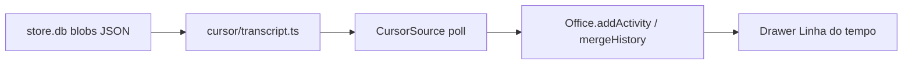

# Linha do tempo do agente Cursor — design

Branch: `feat/cursor-adapter`.  
Contexto: `docs/hrq/CONTEXTO.md` (passo 3).  
Depende do MVP de observação Cursor (`server/sources/cursor/`).

## Objetivo

Preencher a seção **Linha do tempo** do drawer (e a atividade atual / feed) para agentes Cursor, no mesmo formato `Activity` já usado por Claude/Codex — a partir do `store.db` de cada chat.

## O que falta hoje

- Claude: tail do JSONL → `office.addActivity` / `mergeHistory` → drawer via `GET /api/agents/:id`.
- Cursor: `CursorSource` só aplica título; `transcriptPathOf() === undefined`; histórico vazio.

## Fonte de dados

Em `~/.cursor/chats/<hash>/<chatId>/store.db`:

| Peça | Uso no MVP |
| --- | --- |
| Tabela `blobs` | Folhas com JSON plaintext (`role` + `content`) |
| Tabela `meta` | `latestRootBlobId` / chave — **não** usadas para decrypt |
| Blobs binários | Ignorados (árvore cifrada) |
| `meta.json` do chat | `updatedAtMs` como âncora do fim da linha do tempo |

Tipos de `content[]` observados: `text`, `reasoning`, `tool-call`, `tool-result` (`toolName`, `args`, `toolCallId`). Conteúdo de `user`/`system` também pode ser string.

## Decisões

| Tema | Escolha |
| --- | --- |
| Escopo | Só linha do tempo + atividade atual / feed (`addActivity`) |
| Fora | Terminal SSE, decrypt AES, hooks/aprovar, `agent-transcripts` |
| Parser | `server/sources/cursor/transcript.ts` → `parseCursorStore` |
| SQLite | `node:sqlite` `DatabaseSync` readonly (Node ≥ 22.12; sem `better-sqlite3`) |
| Ids | Estáveis por `toolCallId` (normalizado) ou `rowid`+índice |
| Tempo | Ordem `rowid` + `updatedAtMs` no fim (sem timestamp por blob) |
| Live | Poll do mtime de `store.db`; atividades novas → `addActivity` |
| Boot | Prefixo antigo → `mergeHistory` (sem flood no feed), como Claude |
| API | Sem rota nova; histórico já sai do `Office` |

## Arquitetura

## Critério de pronto

Abrir um agente Cursor no Habblaud e ver a **Linha do tempo** com ferramentas (Read/Shell/…) alinhadas ao chat; Claude/Codex inalterados.
